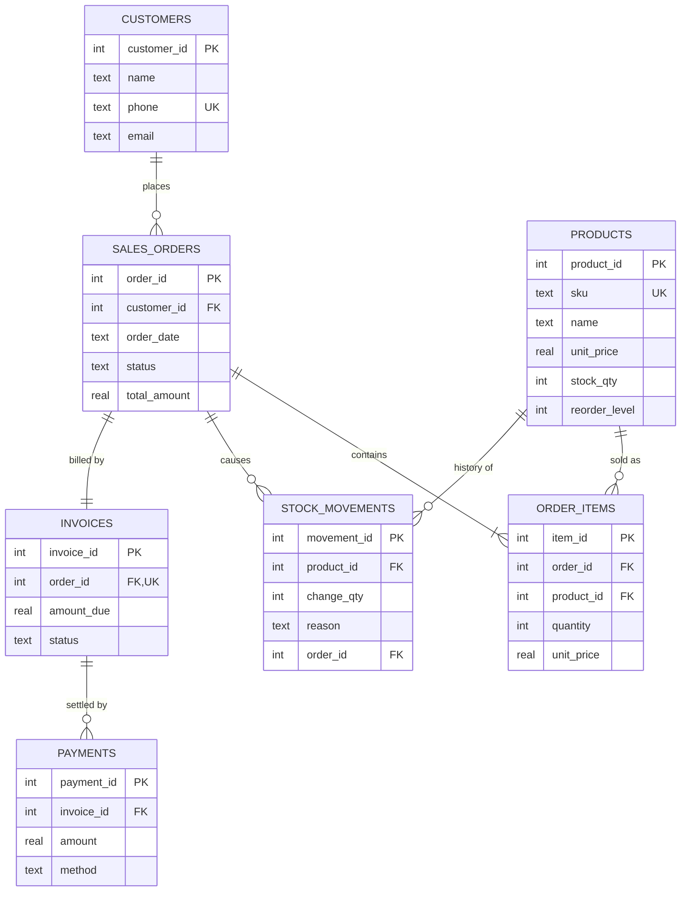

# System Architecture & Database Schema

## 1. Organization and scope
A small retail shop (groceries). The prototype integrates **three modules on one database**:

| Module | Responsibility | Tables |
|---|---|---|
| Inventory | Products, stock levels, audit trail of stock changes | `products`, `stock_movements` |
| Sales | Customers, orders and order lines | `customers`, `sales_orders`, `order_items` |
| Finance | Invoices and customer payments | `invoices`, `payments` |

All modules read and write the same SQLite file (`retail_erp.db`). There are no copies of data
between modules; modules link to each other only through foreign keys.

## 2. Entity-Relationship diagram



If Mermaid does not render in your viewer, paste the block into https://mermaid.live to get the picture.

## 3. Data flow: one sale touches all three modules
`erp.place_order()` runs this as **one database transaction**:

```
Sales order entered
   |-- SALES:     insert sales_orders row + order_items rows
   |-- INVENTORY: products.stock_qty reduced, stock_movements row (SALE) written
   |-- FINANCE:   invoices row created (status UNPAID, amount_due = order total)
   v
COMMIT (all succeed)   or   ROLLBACK (any step fails: nothing is saved)
```
Later flows: `record_payment()` adds a `payments` row and moves the invoice UNPAID → PARTIAL → PAID.
`cancel_order()` returns stock (`CANCEL_RETURN` movement), marks the order CANCELLED and the invoice VOID.

## 4. How the design enforces a single source of truth
| Rule | Mechanism |
|---|---|
| No duplicate products / customers | `UNIQUE` on `products.sku` and `customers.phone` |
| Stock can never be negative | `CHECK (stock_qty >= 0)` plus a stock check in code |
| Prices and quantities must be positive | `CHECK (unit_price > 0)`, `CHECK (quantity > 0)` |
| No orphan records | Foreign keys with `PRAGMA foreign_keys = ON` |
| History cannot be destroyed | `ON DELETE RESTRICT` on products/customers that have orders |
| One invoice per order | `UNIQUE` on `invoices.order_id` |
| Valid statuses / methods only | `CHECK (status IN (...))` |
| Price history preserved | `order_items.unit_price` copies the price at sale time |
| Stock is auditable | `stock_qty` must equal the sum of `stock_movements` (checked in `test_erp.py`) |
| No half-finished transactions | `with conn:` commits or rolls back everything together |

## 5. Known limitations (honest list)
- Money is stored as `REAL` (floating point). Acceptable for a prototype in a currency without decimals, but a production system should store integers or use `DECIMAL`.
- `products.stock_qty` is stored data that is also derivable from `stock_movements`. It is kept for speed and verified by a test, which is a deliberate (documented) denormalization.
- No user accounts, roles or login. No tax, discounts, suppliers, purchase orders or refunds.
- SQLite is single-file and suited to one shop; it is not built for many simultaneous users.
- Two interfaces (web dashboard in `web.py`, terminal menu in `app.py`) share the same logic in `erp.py`. The web server is Python's basic built-in server: fine for a demo, not for production (no login, no HTTPS, one request at a time).
